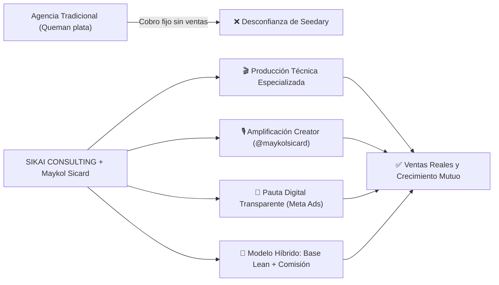
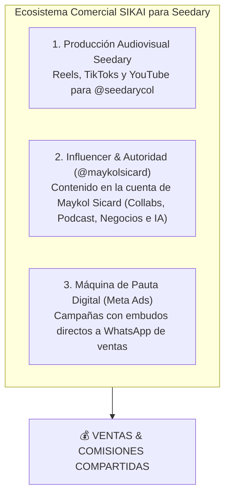

# Alianza Estratégica de Crecimiento y Contenido Digital
## Cliente: SEEDARY COLOMBIA S.A.S. | Presenta: SIKAI CONSULTING (Maykol Sicard)

---

### 1. El Elefante en la Habitación: Cómo Desarmar el Miedo a "Otra Agencia que No Cumple"

Los dueños de Seedary han tenido malas experiencias o se sienten estafados por agencias de marketing y freelancers tradicionales que:
* Cobran mensualidades fijas por "hacer videos o posts" y luego se desentienden de si la empresa vende o no.
* No cumplen con tiempos de entrega ni calidad técnica.
* Se gastan el dinero de pauta sin rendir cuentas claras ni generar leads reales a WhatsApp.

> [!IMPORTANT]
> **Tu postura en la reunión:** No vas como "otra agencia que vende videos".  
> Te presentas como **SIKAI Consulting**, una consultora de crecimiento de negocios y automatización comercial liderada por un creador de contenido real (**Maykol Sicard - @maykolsicard**), donde **pones la piel en el juego (*skin in the game*) alineando tus ingresos al éxito en ventas de Seedary**.

---

### 2. El Ecosistema 3 en 1 de la Propuesta

A diferencia de un editor de video aislado, SIKAI Consulting entrega un sistema comercial completo:

#### Pilar 1: Producción de Contenido para Canales de Seedary (`@seedarycol`)
* Videos cortos en formato vertical Full HD (1080x1920) con motion graphics, ganchos de alta retención y calidad broadcast.
* Foco en desempacar, demostrar y resolver dudas de la **Bambu Lab A1 Combo, A1 Mini, filamentos, cámaras de seguridad Wi-Fi y cerraduras inteligentes**.

#### Pilar 2: Creator Marketing y Amplificación desde `@maykolsicard`
* **Maykol Sicard** no es un actor contratado; es una figura pública en negocios, optimización de procesos, tecnología e inteligencia artificial.
* **Publicaciones en Colaboración (Collab Posts):** Aparecen simultáneamente en el perfil de Seedary y en `@maykolsicard`, transfiriendo credibilidad inmediata, confianza y una audiencia calificada de profesionales, makers y empresarios.
* **Menciones / Integraciones en el Ecosistema Sikai (Podcast / Shorts):** Mostrar casos de uso reales de cómo un negocio puede implementar fabricación aditiva y automatización con equipos suministrados por Seedary.

#### Pilar 3: Pauta Digital y Tráfico Pago Bicanal (Meta Ads & TikTok Ads)
* Creación de creativos publicitarios específicos con estructura directa de venta e impulso.
* **Meta Ads (Instagram & Facebook):** Campañas de prospección y retargeting agresivo optimizadas para **mensajes directos a WhatsApp Business** de los asesores de Seedary.
* **TikTok Ads (Spark Ads):** Pauta sobre los videos nativos de Maykol Sicard y Seedary con CPMs hasta 40% más económicos en Colombia, aprovechando la viralidad del nicho 3D y tecnología.
* **Transparencia Total del Presupuesto:** Seedary ingresa su propia tarjeta de crédito en sus cuentas publicitarias de Meta y TikTok; SIKAI Consulting gestiona, optimiza y segmenta, pero Seedary ve cada peso invertido en tiempo real en su panel.

---

### 3. Estrategia y Presupuesto de Pauta Publicitaria (Meta Ads + TikTok Ads)

Para que el contenido no dependa únicamente del algoritmo orgánico, se requiere una máquina de captación activa bicanal:

#### Presupuesto Sugerido de Pauta (Pagado directamente por Seedary a las plataformas):
* **Fase de Prueba / Arranque (Mes 1 y 2):** **\$1.000.000 a \$1.500.000 COP al mes** (dividido 60% Meta Ads / 40% TikTok Ads; aprox. \$35.000 a \$50.000 COP diarios).
* **Fase de Escalamiento:** **\$2.000.000 a \$3.500.000 COP al mes** (una vez validados los creativos y públicos con mayor retorno).

#### Estructura del Embudo de Pauta Bicanal:
1. **TikTok Ads (Spark Ads & Discovery):** Impulsamos como anuncio el video orgánico de Maykol Sicard probando la Bambu Lab o una cerradura inteligente. Al no parecer un comercial tradicional, retiene 3 veces más y genera clics de bajo costo hacia WhatsApp o la tienda.
2. **Meta Ads (Prospección de Alta Intención):** Segmentación por intereses hacia ingenieros, arquitectos, diseñadores, makers y dueños de empresas de seguridad con anuncios de gancho: *"¿Pensando en comprar tu primera impresora 3D en Colombia? 3 razones por las que la Bambu Lab A1 con Seedary es la mejor opción"*.
3. **Retargeting Dinámico (Meta):** Anuncios dirigidos a personas que interactuaron con el perfil de Seedary o Maykol Sicard en los últimos 30 días, mostrando el respaldo de garantía local en Bogotá, soporte técnico y entrega inmediata.
4. **Destino de Conversión Directa:** Clic a WhatsApp Business con mensaje precargado rastreable (ej. *"Hola Seedary, vi el video de Maykol Sicard sobre la Bambu Lab A1 y quiero cotizar con el código promocional"*).

---

### 4. Modelos de Cobro: Opciones Híbridas (Base + Comisión Global por Ecosistema)

> [!IMPORTANT]
> **Alcance de la Comisión por Venta (Regla de Oro de la Alianza):**  
> La comisión **NO aplica únicamente a lo que se publique en la cuenta personal de Maykol Sicard**. Aplica a **todas las ventas generadas por el ecosistema completo de contenidos y pauta que SIKAI Consulting produce y gestiona**:
> 1. Videos publicados en los canales oficiales de **Seedary** (`@seedarycol`, YouTube y TikTok).
> 2. Videos y colaboraciones publicados en la cuenta de **Maykol Sicard** (`@maykolsicard`).
> 3. Creativos en video utilizados en las campañas de pauta digital (**Meta Ads y TikTok Ads**).
>  
> *Razón comercial para los dueños:* La base operativa que cobra SIKAI ($1.8M o $2.8M) es intencionalmente reducida (cubre solo costos técnicos mínimos de rodaje y edición). La viabilidad de que SIKAI les produzca entre 8 y 16 videos mensuales con calidad de estudio cinematográfico radica en que **SIKAI es socio de facturación de todo el contenido que crea para Seedary**.

---

#### 🟢 Opción A: "Partnership por Resultados" (La opción anti-desconfianza)
*Diseñada para que sientan cero riesgo y vean que tú solo ganas fuerte si ellos venden.*

* **Base Operativa Fija (Cubre costos de producción y montaje de pauta):**  
  **\$1.800.000 COP / mes**
* **Comisión por Venta Atribuida al Ecosistema (Canales Seedary + Maykol + Ads):**
  * **\$120.000 COP** por cada impresora 3D (Bambu Lab A1 Combo, P1S, X1C) vendida mediante las campañas de video, enlaces rastreados a WhatsApp o el código promocional.
  * **\$80.000 COP** por cada Bambu Lab A1 Mini vendida.
  * **7% sobre el valor neto** de combos de seguridad (cámaras CCTV / controles ZKTeco).
* **Entregables:**
  * 8 Videos de alto impacto al mes (4 para canales de Seedary + 4 en colaboración o canal de @maykolsicard).
  * Montaje, optimización y seguimiento diario de campañas de Meta Ads y TikTok Ads.
* **Presupuesto de Pauta Recomendado:** \$1.000.000 a \$1.500.000 COP/mes (pagados directamente por Seedary a Meta/TikTok).

---

#### ⭐ Opción B: "Crecimiento Acelerado & Autoridad" (Recomendada / Mejor Balance)
*Para dominar el mercado colombiano con volumen constante y pauta profesional.*

* **Base Operativa Fija:**  
  **\$2.800.000 COP / mes**
* **Comisión por Venta Atribuida al Ecosistema (Canales Seedary + Maykol + Ads):**
  * **\$100.000 COP** por cada Bambu Lab A1 / P1S / X1 vendida.
  * **\$60.000 COP** por cada A1 Mini vendida.
  * **5% sobre el valor neto** de kits de seguridad y automatización.
* **Entregables:**
  * **14 Videos Cortos al mes** (8 para canales de Seedary + 6 en co-branding / cuenta de @maykolsicard).
  * **1 Video Largo Insignia para YouTube** (Review a fondo o Guía definitiva de compra).
  * Gestión integral de pauta en Meta & TikTok Ads (pruebas A/B de anuncios, copys, creativos y optimización de coste por lead).
* **Presupuesto de Pauta Recomendado:** \$1.500.000 a \$2.500.000 COP/mes.

---

#### 🤝 Opción C: "Alianza Híbrida Efectivo + Canje de Equipos / Insumos"
*Si buscan recortar el flujo de caja en efectivo:*

* **Base en Efectivo:** **\$1.900.000 COP / mes**
* **Saldo en Insumos / Equipos a precio de importador:** **\$900.000 COP / mes en canje** (filamentos PLA, repuestos, consumibles o abono para nuevas impresoras 3D utilizadas por SIKAI Consulting).
* **Comisión por Venta:** Misma escala de la Opción B.

---

### 5. Mecanismo Transparente de Rastreo y Atribución de Ventas

Para evitar desconfianzas o confusiones sobre qué ventas provinieron de SIKAI Consulting:

1. **Código Promocional Exclusivo (`MAYKOL-SEEDARY`):**  
   * Los videos ofrecen un incentivo comercial real para que el cliente use el código: *"Escribe por WhatsApp con el código MAYKOL-SEEDARY y llévate 1 bobina de filamento adicional gratis (o envío nacional sin costo)"*.  
   * Esto obliga al comprador a identificarse con el código al momento de la compra.
2. **Enlace Rastreado Directo a WhatsApp (API de WhatsApp):**  
   * Los botones de anuncios y links de biografía tienen un texto predeterminado invisible para el usuario que llega al chat: *"Hola Seedary, vi el video con Maykol Sicard y quiero información de la Bambu Lab A1"*.
3. **Cierre de Ventas Cruzado Semanal:**  
   * Una hoja de cálculo compartida en Google Sheets donde se revisan los leads de WhatsApp generados por los anuncios y cuántos cerraron en compra.

---

### 6. Guion Estratégico para la Reunión de Mañana (Manejo Psicológico)

#### Paso 1: Empatía Radical y Validación (Minuto 0 al 4)
> *"Buenas tardes. Antes de hablar de propuestas, quiero decirles algo con total franqueza: sé perfectamente que el sector de agencias y creadores de contenido en Colombia está lleno de gente que promete mucho, cobra mensualidades altas por 'entregar unos videitos' y luego desaparece sin que ustedes vean una sola venta en la caja. Entiendo que estén prevenidos, y si yo estuviera en su posición, pensaría exactamente lo mismo."*

#### Paso 2: El Posicionamiento de SIKAI Consulting (Minuto 4 al 8)
> *"Por eso nosotros no venimos a ofrecerles el paquete típico de agencia. Vengo desde **SIKAI Consulting**. Nosotros somos consultores en crecimiento de negocios, automatización y tecnología. Además, yo personalmente (**Maykol Sicard**) creo contenido en redes sociales en temas de negocios, tecnología e inteligencia artificial. Nosotros no queremos venderles videos aislados; queremos construir un canal comercial predecible que les venda impresoras y equipos de seguridad todas las semanas."*

#### Paso 3: El Demostrador Visual ("Miren el estándar que ya manejamos") (Minuto 8 al 15)
> *"Nosotros no venimos a decirles qué podríamos hacer. Miren lo que **ya tenemos listo**: nosotros mismos probamos sus equipos y producimos esto."*
* **Muestra en tu pantalla:**
  1. El video en el escenario de laboratorio tecnológico (`SAC_Solution_Bambu_A1_Spot_Lab_Studio.mp4`).
  2. El video dinámico de producto (`SAC_Solution_Bambu_A1_Promo_Reel.mp4`).
* **Punto de inflexión:** *"Imaginen que este nivel de producción no solo salga en el Instagram de Seedary, sino que salgamos juntos en colaboración con mi cuenta personal (@maykolsicard), dándole cara visible, confianza y respaldo técnico frente al mercado colombiano."*

#### Paso 4: La Solución a la Desconfianza: Base Lean + Comisión + Pauta Transparente (Minuto 15 al 25)
> *"Para que ustedes estén 100% tranquilos de que tenemos la piel en el juego, nuestra propuesta no es un cobro inflado de agencia:  
> 1. **La Pauta es 100% de ustedes:** Ustedes manejan su cuenta publicitaria de Meta; nadie les toca el presupuesto de anuncios y ven cada peso invertido.  
> 2. **Base de Operación Reducida:** Una base accesible que únicamente cubre nuestros costos de filmación, edición y gestión técnica.  
> 3. **Comisión por Venta:** Nosotros ganamos dinero de verdad cuando ustedes vendan máquinas y kits gracias a las campañas. Si la estrategia funciona y venden 20 o 30 máquinas, ganamos los dos. Si no vendemos, nosotros asumimos el costo de nuestro tiempo."*

#### Paso 5: El Cierre de Prueba de 60 Días (Minuto 25 al 30)
> *"Hagamos un acuerdo de prueba de **60 días** con la Opción A o B. Medimos cuántos mensajes entran a WhatsApp, cuántas máquinas se venden con el código y el impacto en marca. Si en dos meses los números no hablan por sí solos, nos damos la mano y no tienen ningún compromiso. Pero si los resultados son los que proyectamos, habrán encontrado su aliado comercial a largo plazo. ¿Arrancamos este mes?"*
